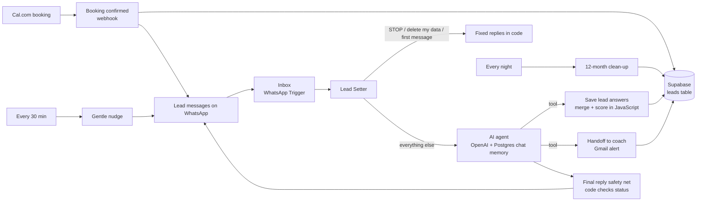

# AI WhatsApp Lead Setter (UK GDPR)

**Demo business:** Second Wind Coaching, a fictional UK online coach for women in perimenopause and menopause.
**Demo video and case study:** [samueloji.netlify.app](https://samueloji.netlify.app)

## The problem

Coaches get leads on WhatsApp in the evening and reply the next morning, by which time the lead has gone cold. The calls that do get booked are often with people who were never a fit. And in a health niche like menopause coaching, a lead's answers are health data under UK GDPR, so they need explicit consent.

## What it does

- Replies to a new lead in seconds, says it's an AI, and links the privacy notice
- Asks for consent before any health question
- Asks the qualifying questions one at a time (stage, goal, timing, budget), with memory per phone number
- Saves and scores every answer in code (0–10), so the AI never decides fit on its own
- Sends good fits a Cal.com link; a webhook marks them as booked and confirms on WhatsApp
- Hands medical, sensitive or out-of-scope messages to the coach by email, with a summary
- Handles `STOP` (opt-out) and `delete my data` (erasure) in fixed code, before the AI sees the message
- Sends one gentle follow-up inside WhatsApp's 24-hour window, only between 8am and 9pm UK time
- Deletes leads and their chat history 12 months after their last message

## How it works



The inbox and the lead setter are separate workflows on purpose: the WhatsApp webhook stays registered while the lead setter is edited and republished.

## Workflows in this folder

| File | What it does |
|------|--------------|
| `inbox.json` | WhatsApp Trigger → passes every incoming message to the lead setter |
| `lead-setter.json` | Reads the message, handles STOP / delete / welcome in code, runs the AI agent, then a code safety net before every reply |
| `save-lead-answers.json` | Tool for the agent: merges new answers, applies consent rules, scores the lead and returns the next step |
| `handoff-to-claire.json` | Tool for the agent: marks the lead as `handoff` and emails the coach a summary |
| `booking-confirmed.json` | Cal.com webhook → marks the lead as `booked` → WhatsApp confirmation |
| `gentle-nudge.json` | Every 30 minutes: one follow-up to quiet leads, with the 24-hour window and UK daytime rules in SQL |
| `12-month-clean-up.json` | Every night: deletes leads and chat history older than 12 months |

**Import order:** import `save-lead-answers.json` and `handoff-to-claire.json` first, then `lead-setter.json`, then `inbox.json`. After importing, reselect the sub-workflows in the lead setter's two tool nodes and in the inbox's "Call Lead Setter" node, because n8n gives each imported workflow a new ID. Publish the sub-workflows before testing.

The Meta helper that subscribes the WhatsApp Business Account to the app is in [`../04-multichannel-support-agent/meta-subscribe-app.json`](../04-multichannel-support-agent/meta-subscribe-app.json).

## Database (Supabase / Postgres)

```sql
create table leads (
  id bigserial primary key,
  phone text unique not null,
  first_name text,
  stage text check (stage in ('peri','post','not_sure','neither')),
  goal text,
  timing text check (timing in ('this_month','1_3_months','just_looking')),
  budget text check (budget in ('yes','payment_plan','not_now')),
  score int,
  status text not null default 'new'
    check (status in ('new','qualifying','qualified','nurture','not_now','handoff','booked')),
  health_consent boolean,
  consent_at timestamptz,
  opted_out boolean not null default false,
  followup_sent_at timestamptz,
  booked_at timestamptz,
  last_message_at timestamptz default now(),
  created_at timestamptz default now()
);
alter table leads enable row level security;
```

The `n8n_chat_histories` table is created automatically by n8n's Postgres Chat Memory node. Enable row level security on it too.

## Design decisions

- **Rules in code, conversation in AI.** Scoring, STOP, erasure, the welcome message and the handoff reply are deterministic. The model only has the conversation, and a code node checks its reply before it's sent.
- **The database is the single source of truth.** WhatsApp, Cal.com and the scheduled jobs never talk to each other directly; they all read and write the same `leads` row, matched by phone number.
- **UK GDPR from the first message:** AI disclosure, a privacy link, explicit consent for health data, opt-out, erasure on request, and a 12-month retention limit. n8n execution logs are pruned after 7 days (`EXECUTIONS_DATA_PRUNE=true`, `EXECUTIONS_DATA_MAX_AGE=168`).

## Stack

n8n (self-hosted in Docker) · OpenAI (gpt-4o-mini) · WhatsApp Cloud API · Supabase (Postgres) · Cal.com · Gmail API · JavaScript · SQL · ngrok
