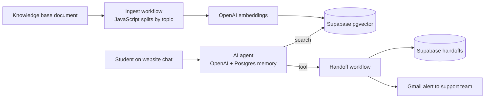

# AI Student Support Agent (RAG)

**Demo business:** Kestrel Coach Academy, a fictional UK coach training academy.
**Demo video and case study:** [samueloji.netlify.app](https://samueloji.netlify.app)

## The problem

Coach training academies answer the same student questions every week: cohort dates, fees, missed sessions, accreditation hours. Refund and payment requests get buried in the inbox, and admin time goes on repeat questions instead of teaching.

## What it does

- Answers students 24/7 from the academy's own knowledge base, and only from it
- Remembers the conversation, so follow-up questions ("can I pay monthly for that?") make sense
- Never promises refunds or exceptions: it collects the student's name and email, logs the request and emails the support team
- Saves every conversation for review

## How it works

## Workflows in this folder

| File | What it does |
|------|--------------|
| `ingest-knowledge-base.json` | Upload form → JavaScript splits the knowledge base into one chunk per `## ` heading → OpenAI embeddings (`text-embedding-3-small`, 1536 dimensions) → Supabase vector store |
| `chat-agent.json` | n8n chat trigger → AI agent with the vector store as a search tool, Postgres chat memory, and the handoff tool |
| `handoff.json` | Logs the request in Supabase and emails the support team |

## Why one chunk per topic

Splitting by fixed character counts cut answers in half (dates in one chunk, times in the next). Splitting at each `## ` heading means every search returns a complete topic, so the agent answers from a full source.

## Stack

n8n · OpenAI · Supabase (pgvector) · Postgres chat memory · Gmail API · JavaScript · SQL · Docker
