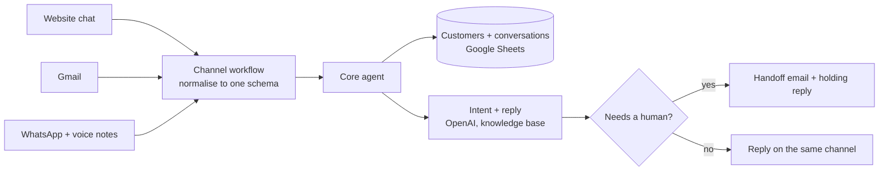

# Multi-Channel AI Support Agent

**Demo business:** Tillstone, a fictional fintech.
**Demo video and case study:** [samueloji.netlify.app](https://samueloji.netlify.app)

## The problem

Customers reach out on three different channels, so questions go unanswered and the team repeats the same replies all day.

## What it does

- One AI agent answers website chat, email and WhatsApp from the same knowledge (products, FAQs, policies)
- Every channel's message is turned into one standard format before it reaches the agent
- Voice notes on WhatsApp are transcribed
- Duplicates and empty messages are filtered out
- Recognises returning customers and logs every conversation
- Escalation rules decide when a human is needed; the team gets a handoff email with a summary, and the customer gets a holding reply
- The reply goes back on the same channel, with a polite fallback if anything fails

## How it works

## Workflows in this folder

| File | What it does |
|------|--------------|
| `core-agent.json` | The shared brain: customer matching, conversation log, intent detection, knowledge base answer, escalation rules, reply routing |
| `channel-website-chat.json` | Website chat → standard format → core agent |
| `channel-email-gmail.json` | Gmail → standard format → core agent → reply in the same thread |
| `channel-whatsapp-meta.json` | WhatsApp Cloud API (Meta) → standard format → core agent → WhatsApp reply |
| `channel-whatsapp-simulated.json` | The same WhatsApp flow with simulated messages, for testing without Meta |
| `voice-note-transcription-nodes.json` | Node group that downloads a WhatsApp voice note and transcribes it |
| `error-alerts.json` | Error workflow that emails an alert when any run fails |
| `meta-subscribe-app.json` | One-click helper that subscribes the WhatsApp Business Account to the Meta app (run it if Meta stops delivering messages) |

## Stack

n8n · OpenAI · WhatsApp Cloud API · Gmail API · Google Sheets · JavaScript
